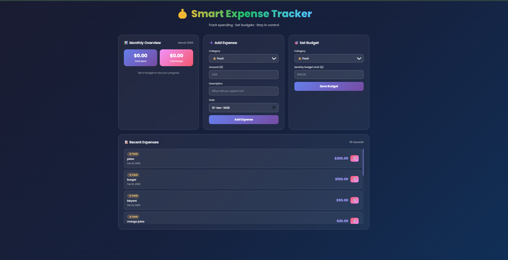

# 💰 Smart Expense Budget Tracker

A modern, creative expense tracking system built with PHP and MySQL featuring a beautiful gradient UI design.


## 📸 Project Screenshots

### Screenshot 1


## ✨ Features

- **Add Expenses**: Track expenses by category with descriptions and dates
- **Set Budgets**: Define monthly budgets for different spending categories
- **Visual Progress**: See spending progress with animated progress bars
- **Category Tracking**: 7 pre-defined categories (Food, Transport, Entertainment, Utilities, Shopping, Health, Other)
- **Monthly Overview**: Real-time budget vs. spending comparison
- **Responsive Design**: Beautiful gradient UI with smooth animations
- **Delete Functionality**: Remove expenses as needed

## 🚀 Installation

### Prerequisites
- PHP 7.4 or higher
- MySQL 5.7 or higher
- Apache/Nginx web server
- phpMyAdmin (optional, for database management)

### Step 1: Database Setup

1. Open phpMyAdmin or MySQL command line
2. Import the `setup.sql` file:
   ```sql
   mysql -u root -p < setup.sql
   ```
   OR copy and paste the contents of `setup.sql` into phpMyAdmin's SQL tab

3. The script will create:
   - Database: `expense_tracker`
   - Tables: `expenses`, `budgets`
   - Sample data for testing

### Step 2: Configure Database Connection

1. Open `index.php`
2. Update the database credentials (lines 5-8):
   ```php
   $host = 'localhost';
   $dbname = 'expense_tracker';
   $username = 'root';  // Change if needed
   $password = '';      // Add your password
   ```

### Step 3: Deploy Files

1. Copy `index.php` to your web server directory:
   - **XAMPP**: `C:\xampp\htdocs\expense-tracker\`
   - **WAMP**: `C:\wamp64\www\expense-tracker\`
   - **MAMP**: `/Applications/MAMP/htdocs/expense-tracker/`
   - **Linux**: `/var/www/html/expense-tracker/`

### Step 4: Access the Application

Open your browser and navigate to:
```
http://localhost/software/index.php
```
OR
```
http://localhost/software/
```

## 📊 Usage

### Adding an Expense
1. Fill in the "Add Expense" form with:
   - Category (dropdown)
   - Amount
   - Description
   - Date
2. Click "Add Expense"

### Setting a Budget
1. Fill in the "Set Budget" form with:
   - Category (dropdown)
   - Budget Amount
2. Click "Set Budget"
3. View budget progress in the card below

### Deleting an Expense
1. Find the expense in "Recent Expenses"
2. Click the 🗑️ delete button
3. Confirm deletion

## 🎨 Design Features

- **Gradient Background**: Purple gradient (667eea → 764ba2)
- **Animated Cards**: Smooth hover effects and transitions
- **Color-Coded Categories**: Each category has unique colors
- **Progress Visualization**: Dynamic progress bars
- **Responsive Layout**: Grid system adapts to screen size
- **Custom Scrollbars**: Styled scrollbars for lists
- **Modern Typography**: Poppins font family

## 📁 File Structure

```
expense-tracker/
├── index.php       # Main application file (frontend + backend)
├── setup.sql       # Database setup script
└── README.md       # This file
```

## 🔧 Database Schema

### expenses table
- `id`: Primary key
- `category`: Expense category
- `amount`: Expense amount (decimal)
- `description`: Expense description
- `date`: Expense date
- `created_at`: Timestamp

### budgets table
- `id`: Primary key
- `category`: Budget category
- `amount`: Budget amount (decimal)
- `month`: Budget month (YYYY-MM format)
- `created_at`: Timestamp
- `updated_at`: Timestamp

## 🎯 Categories

1. 🍔 Food
2. 🚗 Transport
3. 🎮 Entertainment
4. 💡 Utilities
5. 🛍️ Shopping
6. ⚕️ Health
7. 📌 Other

## 🔒 Security Notes

- Uses PDO with prepared statements to prevent SQL injection
- Session management for future user authentication
- Input validation on all forms
- Proper error handling

## 🛠️ Customization

### Change Colors
Edit the CSS gradient values in `index.php`:
```css
background: linear-gradient(135deg, #667eea 0%, #764ba2 100%);
```

### Add More Categories
1. Add options in the dropdown selects
2. Add corresponding CSS classes for colors

### Modify Database
Edit `setup.sql` and re-import to update schema

## 📝 License

Free to use for personal and commercial projects.

## 🤝 Support

For issues or questions, check the code comments or modify as needed!

---

Enjoy tracking your expenses! 💸
